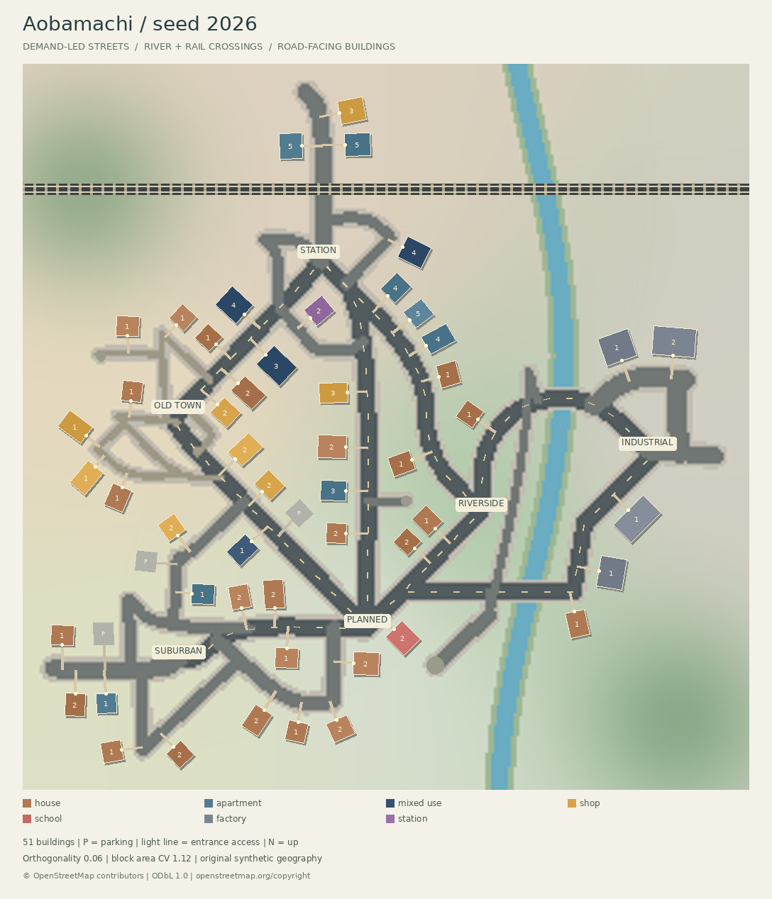

# Minecraft AI City Generator

**現実の都市の数値特徴を混ぜ、架空の日本風都市をMinecraft Java Edition向けに生成する、実行可能なPython MVPです。** OSMの元の道路・建物座標を生成器に渡さず、道路密度、区画面積、建物密度、高さなどの統計から新しい配置を作ります。



同梱の実データ生成例は256×256ブロック、seed=2026。駅前・旧市街・郊外住宅地・新興住宅地・工業地・河川沿いの6地区、7種類の建物、河川・橋・高架鉄道を含みます。これは東京や京都の地図の再現ではありません。

**v0.2ではCLIの既定を `organic` へ変更しました。都市全体の格子を作らず、施設間の接続需要から幹線を引き、生活道路を分岐させます。** 旧方式は `--layout legacy`、保存済みの旧 `city.json` もそのまま再建築できます。詳細は [自然な都市構造の実装・検証](docs/NATURAL_CITY.md) を参照してください。

[6シードの比較画像](examples/natural-comparison/comparison.png) / [品質比較JSON](examples/natural-comparison/comparison.json)

**v0.2.1では、既存都市を保ったまま都市名・区・地区・占有敷地を管理する `project` コマンドを追加しました。** [管理機能の使い方](docs/PROJECTS.md) / [統合要件と段階的な開発方針](docs/ROADMAP.md)。自然言語編集・Web地図・Paper連携は後続フェーズです。

再開後の最終確認は **172テスト通過**。6シード比較、新旧schematicと管理情報変更前後の再現性を確認済みです。[検証記録](VERIFICATION.md) / [開発・再開ログ](DEVELOPMENT_LOG.md) / [生成例一覧](examples/README.md)

## 1. 環境構築

Python **3.10以上**。この環境ではPython 3.12で動作確認しました。GUI、Minecraftサーバー、GPU、APIキーは生成に不要です。

```bash
cd minecraft-ai-city
python -m venv .venv
source .venv/bin/activate
python -m pip install -e ".[dev]"
```

Windows PowerShellでは仮想環境を `.venv\Scripts\Activate.ps1` で有効化してください。インストール後は `citygen` または `python -m minecraft_city` を使えます。

検証環境の固定バージョンは `requirements-lock.txt` にあります。同じ依存バージョンで再現する場合は、Python 3.12で `python -m pip install -r requirements-lock.txt`、続いて `python -m pip install -e . --no-deps` を実行してください。他のPythonバージョンでは通常の `pyproject.toml` によるインストールを推奨します。

## 2. 最短で動かす：ネットワーク不要のデモ

```bash
citygen demo --seed 42 --output output/demo
```

初回の依存導入後は、通信もAPIキーも使いません。東京風・京都風の**合成サンプル形状**を分析し、60:40で混ぜます。サンプルは実測データを装わず、JSONの `source: synthetic_sample` とプレビューに明示します。

| ファイル | 内容 |
| --- | --- |
| `profiles/*.json` | サンプル都市の分析結果（demo時） |
| `city.json` | シード、統計、計画、道路、地区、全建物、検証結果 |
| `plan.json` | 再利用・手動編集できる構造化都市計画 |
| `preview.png` | 地区・道路・建物種別を色分けした2Dマップ。数字は階数 |
| `city.schem` | WorldEdit用Sponge Schematic v2、gzip圧縮NBT |
| `report.json` | 接続・重複検査、出典、パレット数、出力サイズ |

同じ出力ディレクトリで実行すると既存の生成物を上書きします。比較する場合は別のディレクトリを指定してください。

## 3. 実際のOSMデータを分析・比較する

地域プリセットは都市全域ではなく、約0.48 km²の小範囲です。

```bash
citygen analyze --region tokyo --output output/profiles/tokyo.json
citygen analyze --region kyoto --output output/profiles/kyoto.json
citygen compare output/profiles/tokyo.json output/profiles/kyoto.json \
  --output output/comparison.json
```

任意範囲は緯度経度の `南,西,北,東` 順で指定します。

```bash
citygen analyze --bbox 35.001,135.758,35.007,135.766 \
  --name "Kyoto small area" --output output/profiles/custom.json
```

- Overpass APIに道路・建物・土地利用を**1回のリクエスト**で問い合わせます。Nominatimにはアクセスしません。
- リクエストは最大4 km²、各辺4 km、最小辺50 mに制限。タイムアウトを設定し、自動リトライや大量並列取得は行いません。
- `.cache/osm` に応答と取得時刻を保存し、同じ範囲は再取得しません。更新が必要な場合だけ対応するキャッシュを移動・削除してください。
- 通信失敗・タイムアウト・不完全な応答では、警告を出して合成サンプルに切り替えます。実データのみ許可する場合は `--no-fallback` を指定します。
- `--sample tokyo` / `--sample kyoto` は最初からオフライン分析を行います。

**2026-10-11に実取得した東京・京都のプロファイルと比較結果を `examples/osm-v2/` に同梱しています。** 公開OSMの元応答も `examples/osm-v2/raw/` に収録しています。同梱のキャッシュから同じ分析を再計算できます。

```bash
citygen analyze --region tokyo --cache-dir examples/osm-v2/raw \
  --no-fallback --output output/reanalyzed-tokyo.json
```

### 指標の意味とデータ品質

UTMへ投影して距離・面積をメートル単位で計算します。道路密度は道路長/km²、交差点密度は次数3以上の点/km²、建物密度は棟/km²、被覆率は建物面積の和集合/分析面積です。

- 区画面積は道路網の閉じた面の中央値です。登記上の筆・敷地境界ではありません。閉路がなければ0を記録し、計画時に既定値を使います。
- 道路はOSMの `highway` 線形要素を含み、歩道・小道も含みます。面指定の広場は道路線から除外します。交差点は2D幾何上の交点で、立体交差・橋・トンネルを分離した交通解析ではありません。
- 直交性は道路方位の4倍角の長さ加重平均です。回転した格子も高い値になり、0〜1の規則性指標として扱います。
- 建物高さは `height`（mまたはft）、次に `building:levels × 3 m`、欠損時は9 mです。`height_tag_coverage` に実タグの割合を残します。
- 土地利用比率は分類できた住宅・商業・公園の面積に対する比率。工業を商業、森林・レクリエーション地を公園へまとめるMVPの簡略化があります。
- `landuse_tag_coverage` に分類済み領域の面積率を保存し、タグが疎なときは既定の住宅65%・商業25%・公園10%を補間します。今回の小範囲では土地利用タグが少なく、公園だけのタグから「街全体が公園」と推定しないようにしています。
- OSMの建物タグ・高さ・土地利用の欠損や、データ更新による差があります。結果は都市の正確な統計調査ではありません。

## 4. 特徴を混ぜてオリジナル都市を生成する

同梱の**実OSM分析データ**を使えば通信なしで実データ由来の都市を生成できます。

```bash
citygen generate \
  --profile examples/osm-v2/tokyo.json \
  --profile examples/osm-v2/kyoto.json \
  --weights 0.6 0.4 \
  --planner rules --seed 2026 --size 256 \
  --output output/japan-city
```

`--profile` の順番と `--weights` の順番を対応させます。重みは非負、合計正。`60 40` のような値も自動正規化します。省略時は均等です。サイズは128〜512に対応し、MVPの標準は256です。

生成の仕組み：

1. 指標を重み付き平均し、道路間隔、道路の歪み、建物の大きさ・密度、階数、地区配分へ変換します。
2. 駅と地区中心の接続需要から最小全域木と補助接続を選び、河川・鉄道・丘陵の通行コストを使って幹線を経路探索します。その道路から、地区に応じた生活道路・路地・行き止まりを伸ばします。経路探索の計算用ラスタ全体を道路として出力することはありません。
3. 道路の接線方向へ敷地・建物を回転して配置し、入口から道路へ接続する専用路も確保します。駐車場・空き地を挟み、地区境界では建築スタイルを確率的に混ぜます。
4. 道路接続、敷地外配置、建物・交通・河川との衝突、入口通路の閉塞、橋・鉄道横断位置を検証します。屋根・ベランダと回転によるブロック化の余裕も含めます。格子偏重・区画多様性・地区差を品質レポートに出します。
5. ブロック化し、プレビューと `.schem` を保存します。

実都市を1:1スケールで再現する方式ではありません。1ブロック≒1 mを基準に、256ブロックへ収まるよう道路間隔を32〜64へ圧縮します。organicの指定比率は各地区の勢力圏を調整する目標です。6地区の最低限の確保や河川・道路面積のため厳密な面積率とは一致しません。legacyでは地区数の丸めを使います。建物被覆率も目標の傾向を反映する値であり、厳密な一致は保証しません。実際の値は `report.json` の `achieved_building_coverage` で確認できます。

### プレビュー・再生成・再現

```bash
# seedを変え、別の道路・建物配置へ
citygen generate --profile examples/osm-v2/tokyo.json --profile examples/osm-v2/kyoto.json \
  --weights 0.6 0.4 --planner rules --seed 2027 --output output/seed-2027

# 保存済みの都市を再描画する
citygen preview --city output/japan-city/city.json --output output/map.png --scale 4

# 保存済みの計画を固定し、同じseedで再生成する
citygen generate --profile examples/osm-v2/tokyo.json --profile examples/osm-v2/kyoto.json \
  --weights 0.6 0.4 --plan-file output/japan-city/plan.json --seed 2026 --output output/replay

# 保存済みの全配置から建築ファイルを再出力する
citygen build --city output/japan-city/city.json --output output/rebuild
```

同じソフトウェア・依存バージョン、プロファイル、重み、計画、サイズ、シードで同じ配置と同じ `.schem` バイト列を再現します。gzipの時刻情報も固定しています。新しいOSM取得結果や新しいAI提案は変化しうるため、完全な再現には保存済みの `city.json` を使ってください。

## 5. AIによる構造化都市計画（任意）

OpenAI APIは環境変数で設定します。キーをファイルやソースに埋め込む必要はありません。`.env` の自動読み込みはしません。

```bash
export OPENAI_API_KEY="your-key"
export OPENAI_MODEL="gpt-4.1-mini"  # 任意
citygen generate --profile examples/osm-v2/tokyo.json --profile examples/osm-v2/kyoto.json \
  --weights 0.6 0.4 --planner ai --seed 42 --output output/ai-city
```

PowerShellでは `$env:OPENAI_API_KEY="your-key"` を使います。

- `--planner auto`（generateの既定）: キーがあればAI、なければルール。
- `--planner rules`: 常に通信なし。`demo` も常にこのモードです。
- `--planner ai`: AIを試行し、キーなし・API障害・拒否・不正JSON・範囲外の提案なら警告付きでルールへ戻ります。

AIへ送るのは混合済み指標、seed、基準計画のみです。Structured OutputsのJSON SchemaとPydanticの二段階で、道路幅・間隔、地区比率の合計、階数、スタイル、余分なフィールドなどを検証します。任意コードや任意Minecraftブロック名は受け付けません。`traditional` / `modern` / `mixed` に応じたパレット・屋根・外装を建築器が適用します。生成元は `planning_source` に記録します。

AIのAPI応答そのものは決定的ではありません。同じseedだけで同じ提案が得られる保証はなく、`plan.json` を保存して再利用してください。この作業環境にはAPIキーがないため、実API呼び出しは未検証です。成功・拒否・不正JSON・タイムアウト・キー欠損はモック通信で検証済みです。

## 6. Minecraft Java / WorldEditへの読み込み

出力は **Sponge Schematic v2 / Minecraft 1.20.1 DataVersion 3465**。NBTは `nbtlib` を使い、パレットとunsigned VarIntのBlockDataを実装しています。Xが最速、次がZ、最後がYの順です。

1. Minecraft Java 1.20.1以上と、それに対応するWorldEdit 7系を用意します。
2. `city.schem` をサーバーの `plugins/WorldEdit/schematics/`、または導入方式に応じたWorldEditのschematicsフォルダへコピーします。
3. 建築可能な空間の北西・下端となる位置で読み込みます。

```text
//schem load sponge city
//paste
```

WorldEditの版によっては `//schem load city` でも読み込めます。`//paste -a` は空気を貼り付けないため、既存地形のある場所では建物内部に地形が残ります。通常の貼り付けは空気を含む範囲を置換するので、空のテストワールドで位置を確認してください。取り消しは `//undo` です。

地盤はローカルY=0〜3、歩行面はその上です。organicでは河道を掘り、丘陵も追加しますが、道路・建築周囲は平坦に造成します。貼り付けの基準Yを64にすると地盤上端は67になります。都市のサイズは256×256、高さは建物の階数から自動計算します。既存ワールドの起伏へ合わせる処理はありません。

住宅には段状の瓦風屋根、各建物には窓・入口・屋内照明、マンションにはベランダ、店舗には庇、学校には別配色を付けます。公園には植栽・歩道・ベンチ、道路には歩道・交差点の横断歩道・街灯を配置します。鉄道は高架複線と支持柱を持ち、organicでは道路横断位置で支持柱を避けます。

**実行済みの検証はNBTの保存・読み戻し・全ブロック配列の一致までです。Minecraft/WorldEdit本体をこの環境で起動して貼り付ける検証はしていません。**

## 7. テストと構成

```bash
pytest -q
ruff format --check src tests
ruff check src tests
python -m pip check
```

テストは通信不要です。既知の幾何形状による面積・密度計算、OSM multipolygonの穴・二重計上、キャッシュ、取得失敗、重みとAI JSONの検証、シード再現、異なるseed、複数サイズ、極端な計画の敷地確保、接続・衝突、NBT VarIntの128以上の値、軸順序、全都市の保存・読み戻し、CLI全体を検証します。GitHub Actions設定も同梱しています。

```text
src/minecraft_city/
  analysis.py     Overpass取得・投影・数値特徴抽出・合成サンプル
  models.py       プロファイル・計画・都市のJSON契約
  planning.py     特徴混合・ルール計画・OpenAI構造化出力
  generation.py   旧方式と共通幾何・互換性・接続/衝突検査
  organic.py      接続需要・障害物を考慮した道路と接道敷地
  morphology.py   道路方位・曲がり方・交差点・分布の分析
  quality.py      格子偏重・区画・接道・地区差の品質検証
  comparison.py   複数シード比較・失敗結果の保存
  organic_building.py 回転建物・河川・橋・地形のブロック化
  preview.py      共通幾何からのPNGプレビュー
  building.py     Minecraftブロック建築
  schematic.py    Sponge v2 NBT/VarInt出力
  project.py      名前付きの都市・区・地区・占有敷地管理、参照検証
  cli.py          コマンドライン
tests/           自動テスト
examples/osm-v2/    実OSM分析・比較・元データキャッシュ
examples/demo/   合成サンプルの実行結果
examples/natural-city/ 自然な道路網の実データ60:40生成例
examples/natural-comparison/ 6シードのPNG・都市JSON・品質比較
docs/NATURAL_CITY.md 自然な都市構造の方式・指標・制約
docs/PROJECTS.md    階層管理・設定JSON・互換性
docs/ROADMAP.md     Phase 1〜4の実装状況と後続設計
```

OSMnx/GeoPandasは必須にせず、範囲を限定したOverpass取得、Shapely、PyProj、NetworkX、NumPyで必要な処理を実装しました。出力用nbtlibを含め、依存をこの環境にインストールして実行しています。

## 8. MVPの制限・未実装

- 都市生成は**手続き型アルゴリズム＋任意のLLM計画**です。都市データから訓練した生成モデルや街路の機械学習モデルは未実装です。
- organicは接続需要と障害物を考慮した曲線・分岐型、legacyは格子型です。実DEMによる道路勾配設計、地下鉄、交通シミュレーション、大規模都市の分割出力は未実装です。丘陵・河川形状は合成で、OSMの地形そのものを再現しません。
- 建築は種類別パラメトリック雛形です。詳細な内装、階段・エレベーター、学校の校庭、営業駅のホーム・改札・鉄道ダイヤは未実装です。駅舎の雛形は実装しています。2階以上には床がありますが、屋内昇降設備はありません。
- organicは全建物の入口専用路と幾何上の接道・閉塞検査を実装しています。Minecraft内の歩行AIによる経路テスト、実OSMの全立体交差を分離した交通グラフは未実装です。回転建物の扉・階段の向きはMinecraftが持つ4方位へ丸めます。
- プレビュー・seed変更はCLIで行います。ブラウザ/Tkのインタラクティブ編集GUI、Minecraftへの直接接続、`.mcworld`/Anvil保存は未実装です。
- `project` による区・地区の登録や希望用途の保存は実装済みですが、範囲指定による実際の拡張・再開発、変更の承認・undoは未実装です。新しい管理地区は空の予約情報として保存し、既存の道路・建物を変更しません。敷地は占有形状で、完全な宅地分割ではありません。
- プレビューは敷地と地区の平面図で、Minecraftの3Dレンダリングではありません。
- 実AI APIとゲーム本体内の読み込み検証は上記の通り未実施です。

## 9. OSMライセンス・API利用条件

コードはMIT。OSM由来の元データ・派生分析データは別ライセンスとして扱います。**© OpenStreetMap contributors**、[Open Database License (ODbL) 1.0](https://opendatacommons.org/licenses/odbl/1-0/)、[OSM著作権表示](https://www.openstreetmap.org/copyright)。詳細と同梱範囲は [DATA_LICENSE.md](DATA_LICENSE.md) を参照してください。

公開・再配布する地図・都市成果物にも出典を付けてください。本実装はプロファイル、都市JSON、レポート、プレビュー、schematicメタデータに出典を保持します。OSMの元データや派生データベースを配布するときはODbLの表示・継承・提供義務に従ってください。

公開Overpassサーバーには[利用に関する案内](https://wiki.openstreetmap.org/wiki/Overpass_API#Public_Overpass_API_instances)と[資源制限](https://dev.overpass-api.de/overpass-doc/en/preface/commons.html)があります。小範囲・キャッシュ・逐次実行を守り、429/504等の場合は時間を置くか合成サンプルを利用してください。連続した都市全域取得には公開インスタンスへ大量アクセスせず、適切な抽出データや自前インスタンスを使う設計が必要です。

## 10. GitHubリポジトリ

`.gitignore` は `.venv`、ビルド・キャッシュ・一時出力、`.env` / `.env.*`、秘密鍵・代表的な認証情報ファイルを除外します。README用の公開OSMデータと完成例は追跡対象にできるよう残しています。`.gitignore` は既に追跡済みのファイルから秘密を除去する機能ではないため、保存先で `git status` と差分を確認してください。

保存先は [datugokugames/minecraft-ai-city](https://github.com/datugokugames/minecraft-ai-city) です。コード・テスト・ドキュメント・公開OSM資料・生成例を管理します。仮想環境、キャッシュ、ビルド出力、ZIPや認証情報は含めません。pushとpull requestでPython 3.10/3.12のGitHub Actionsが実行されます。

2026-10-11時点でローカルコミットは作成済みですが、この作業環境からのGit pushと接続アプリによるファイル作成はどちらも403で拒否され、GitHubへの反映は未完了です。接続アプリの書き込み権限が必要です。以下のclone手順はアップロード完了後に使用してください。

```bash
git clone https://github.com/datugokugames/minecraft-ai-city.git
cd minecraft-ai-city
python -m venv .venv
```

続いて「環境構築」の手順で仮想環境を有効化し、依存を導入してください。`release-v0.2.1.json` はGitHubへの取り込み前に配布したZIPの検証用ハッシュ一覧です。Git管理後の文書変更や、Gitから除外したwheelも含むため、現在のGitツリー全体のハッシュ一覧ではありません。

## 11. 都市・区・地区に名前を付ける

```bash
citygen project init --city examples/natural-city/city.json \
  --name 青葉市 --ward-name 中央区 --output output/project-initial.json
citygen project configure --project output/project-initial.json \
  --settings examples/management/settings.json --output output/project-configured.json
citygen project inspect --project output/project-configured.json
citygen project export --project output/project-configured.json --output output/managed-city
```

同梱設定は中央区・北区を登録し、地区名・所属・希望する用途/外観を設定します。未指定地区は保持します。`project.json` に元都市の全データを含み、同じ建築エンジンで再出力できます。新しいファイル・ディレクトリに保存し、既存スナップショットへの上書きは拒否します。詳しい契約と制限は [PROJECTS.md](docs/PROJECTS.md) を参照してください。

Windowsの8GB RAM・HDD環境では、まず256×256を生成してから空のテストワールドへ貼り付けてください。全都市の配列を生成する現方式では、サイズを大きくするとメモリと処理時間が増えます。Paper稼働中の負荷・HDDでの貼り付け性能は未測定で、現段階では大都市規模やリアルタイム編集に対応していません。
