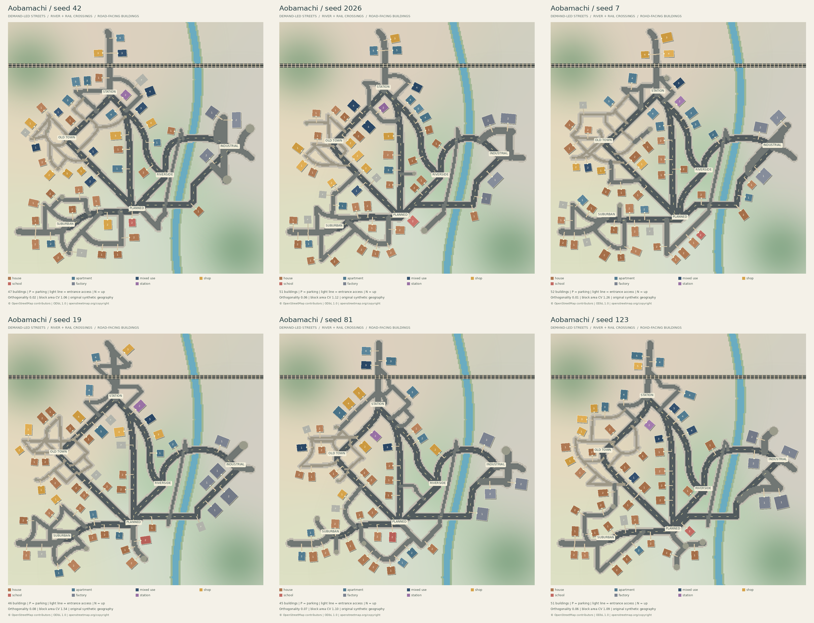

# 自然な都市構造：v0.2

CLIの `demo` / `generate` は `--layout organic` が既定です。元の格子生成器は `--layout legacy` として残し、旧JSONも読み込めます。Python APIの `generate_city` の既定は互換性のためlegacyのままなので、新方式を使う場合は `layout="organic"` を指定してください。



## 実行

```bash
# オフライン。合成の分析用サンプルから自然な街を生成
citygen demo --seed 42 --output output/natural-demo

# 実取得済みの東京・京都の特徴を60:40で合成
citygen generate --profile examples/osm-v2/tokyo.json \
  --profile examples/osm-v2/kyoto.json --weights 0.6 0.4 \
  --planner rules --seed 2026 --output output/natural-city

# 複数シードのPNG・都市JSON・品質指標・一覧画像を作る（schemは作らない）
citygen compare-seeds --profile examples/osm-v2/tokyo.json \
  --profile examples/osm-v2/kyoto.json --weights 0.6 0.4 \
  --seeds 42 2026 7 19 81 123 --output output/comparison

# 選んだ都市をそのままMinecraft用に建築
citygen build --city output/comparison/seed-2026/city.json --output output/selected

# 既存都市も同じ指標で評価
citygen evaluate --city examples/japan-city/city.json --output output/legacy-quality.json

# 以前の方式も明示指定できる
citygen demo --layout legacy --seed 42 --output output/legacy
```

`compare-seeds` は失敗したシードも比較JSONと画像に記録して終了コード2を返します。良好なシードだけを選んで結果を隠す処理はありません。profile省略時は合成サンプル2地域を使用します。比較用画像は全建物の敷地・接道方向・入口通路・駐車場を表示し、地区の背景色は連続的に補間します。

## 実データの追加分析

従来の道路・建物・土地利用に加え、同じ小範囲の `waterway`、`railway=rail`、`ele` をOverpassから取得します。既存の4 km²制限、キャッシュ、タイムアウト、失敗時の明示的なサンプル切替を維持しています。新クエリは別キャッシュキーなので、v0.1の古い応答を完全な地形情報と誤認しません。

| 指標・分布 | 計算方法 | 新方式への反映 |
| --- | --- | --- |
| `road_sinuosity` | 道路長 / 両端の直線距離。閉じた道路は比率計算から除外 | 経路の平滑化量 |
| `turn_degrees_per_km` | ポリラインの方向変化の絶対値 / km | 分析・生成後の評価 |
| `direction_15deg_share`、`orientation_entropy` | 長さ加重の方位分布（180°、12区間）、正規化エントロピー | 経路探索の方向コスト。分布そのものもJSON保存 |
| T字・十字・変則交差点比率 | 線の交点でノード化。次数3と直進対、次数4と約90°、その他 | 品質比較。T字・分岐は接続需要から自然に発生 |
| 幹線・路地比率、道路幅 | highway分類、width、lanes。欠損時はクラス別幅 | 幹線の幅、道路階層別の幅を設定。タグ観測率を記録 |
| `dead_end_share` | 分析境界付近を除いた次数1 / 終端・交差点数 | 意図的な袋路を作る確率 |
| `road_spacing_cv` | 曲がり角の次数2を縮約した、交差点間の道路長の変動係数 | 地区内の接続需要点の間隔のばらつき |
| 区画面積・コンパクトネス・伸長比の分布 | 閉じた道路面をpolygonize、最小回転外接矩形等で集計 | 中央区画面積は基準間隔へ反映。全分布と生成後の区画を比較可能 |
| 河川・鉄道密度、交差数 | 境界内の線長・道路との幾何交差 | 合成河川の幅などの設定、橋・横断位置を限定した経路探索 |
| 高低差・標高サンプル数 | OSMの有効なeleタグの最大最小 | 合成丘陵の高さの目安。標高タグはDEMではない |
| 建物面積・高さ・被覆率、土地利用 | 従来の分析指標 | 敷地寸法、階数、空き地比率、地区の影響範囲 |

幅の実測タグがなければ `width_tag_coverage=0` になります。`ele` が2点未満なら観測高低差は0で、地形を計測できたとは扱いません。古いプロファイルの追加指標には既定値を補います。より正確な比較には新しい `analyze` で再分析してください。

道路間隔は道路に沿う交差点間隔の代理指標であり、街路間の垂直距離ではありません。交差点は2D幾何で判定するため、OSMの橋・トンネルの完全な交通接続復元は未実装です。曲率も厳密な微分曲率ではなく、ポリラインの屈曲と蛇行率を使います。

## 道路・地区・建築の生成順序

1. **合成地理と主要施設**：河川、丘陵、鉄道、橋候補、鉄道横断候補を配置し、駅・旧市街・郊外・新興住宅地・工業地・河川沿いの需要中心を用意します。実地域の座標・河川形状・標高面はコピーしません。
2. **幹線**：需要中心の距離と駅への接続需要で重みを付けたグラフの最小全域木に、冗長な接続を追加します。選んだ接続だけをA*で経路探索します。河道・鉄道をどこでも横断できる設定にはしていません。丘陵には通行コストを加えます。
3. **局地的な生活道路**：既存道路から遠い地区内の需要点へ分岐を伸ばします。別道路へ再接続できるときはループ、条件に応じて行き止まりを設けます。旧市街は細い路地、工業地は広い生活道路、郊外は広めの間隔、新興住宅地は中間的な幅とループを使います。河川沿いには河道に沿った道も設けます。
4. **連続的な地区の変化**：距離と滑らかな変動から地区を作ります。背景色と建築選択の影響は隣接地区から混ぜるため、境界に壁や一律の直線を引きません。JSONの所属地区は集計のための離散ラベルです。
5. **接道敷地**：道路上の候補点で接線と法線を求め、その向きに建物を回転します。張り出しの余白まで道路・河川・鉄道・他の建築と重ならない敷地だけを採用します。入口通路を先に予約し、後から置く建物・駐車場で塞がないようにします。
6. **街並み**：駅前は高層の店舗・雑居ビル、旧市街は低層の家・店舗、郊外は戸建てと駐車場、新興住宅地は現代的な住宅、工業地は大きな工場敷地、河川沿いは植栽と低い密度を基本にします。寸法・階数・外壁・屋根・窓のある雛形を組み合わせます。
7. **ブロック化**：回転建物をローカル座標で建築してからMinecraftの整数格子へ変換します。斜め配置で扉が消えないよう、入口を明示的に掘って上下の扉を設置します。河道を掘り、橋を架け、鉄道の道路横断部には支持柱を置きません。

A*の4ブロック間隔の探索ラスタは通行コストを計算するための内部表現です。そのラスタを道路網にしてずらす方式ではありません。ただし8方向探索を平滑化するため、方位に45°単位の傾向が残ることはあります。道路の平滑化が障害物へ入る場合は、検証済みのより細かな経路へ戻します。

## 品質評価と実行結果

`city.json` の `validation` は接続・衝突・接道の必須検査、`quality` は構造の評価です。`report.json` にも両方保存します。分析上の警告と生成失敗を区別しています。

- **格子偏重**：長さ加重の4倍角方位集中度 > 0.8、十字路比率 > 0.35、道路間隔CV < 0.4のすべてを満たすと警告。都市境界のT字路を含む小地図でも一様な格子を検出できる閾値です。
- **道路終端**：すべての道路は1連結成分。次数1が袋路・地域への出入口・施設の需要中心のいずれにも対応しない場合は警告します。
- **区画多様性**：閉じた道路面が3未満、または面積CV < 0.25なら警告。分位点、形状分布、道路間隔CVも記録します。
- **建物接道**：全建物で、入口が外壁にあること、通路が道路まで届くこと、河川・鉄道や別の建物・敷地に遮られないことを検証します。
- **地区差**：各地区の道路長/面積、平均道路幅、平均階数、平均建築面積、建物種別を比較し、駅前の平均階数が郊外以下なら警告します。

東京60%・京都40%、256×256の同梱6シードの結果：

| seed | 棟数 | 方位集中度 | 区画面積CV | 閉区画数 | 駅前平均階数 | 郊外平均階数 |
| --- | ---: | ---: | ---: | ---: | ---: | ---: |
| 42 | 47 | 0.018 | 1.061 | 22 | 3.38 | 1.67 |
| 2026 | 51 | 0.056 | 1.118 | 17 | 3.82 | 1.44 |
| 7 | 52 | 0.005 | 1.257 | 21 | 3.55 | 1.43 |
| 19 | 46 | 0.076 | 1.540 | 20 | 4.00 | 1.57 |
| 81 | 45 | 0.075 | 1.104 | 20 | 3.10 | 1.44 |
| 123 | 51 | 0.056 | 1.088 | 16 | 3.83 | 1.50 |

全件で道路1連結成分、未分類終端0、建物接道率100%、検証エラー・品質警告0でした。旧MVPの `examples/japan-city/city.json` は方位集中度0.999で、同じ評価器が格子偏重を検出しました。旧保存都市を再建築した `.schem` は以前のファイルとバイト一致しています。

これらの指標は都市としての自然さを保証する絶対的なスコアではありません。比較PNGも目視確認しています。ソースの小さい道路面・路地にはマッピング粒度の影響があり、実都市とのCVや交差点数の厳密一致を目標にはしていません。

## 残る制約

- 需要中心の配置は日本の地方都市を想定した6地区の構成で、あらゆる都市形態を学習したモデルではありません。主な地区の相対位置には共通性があります。
- 基本敷地・建物は回転矩形です。複雑なL字・三角形建築、区画全体を使い切る敷地分割は未実装で、空地が多く残ることがあります。
- 道路形態指標はすべてJSONに記録しますが、全分布へ最適化して一致させる学習・最適化処理はありません。指標から選んだパラメータへ変換する方式です。
- 河川と丘陵は合成。実DEM、洪水、道路の縦断勾配、切土・盛土の連続設計は未実装です。道路と建築周辺は平坦に造成します。
- 駅舎は建築雛形で、営業可能なホーム・改札・ダイヤはありません。建物の階段・エレベーターも従来どおり未実装です。
- 道路幅・曲率・敷地の見た目はMinecraftのブロック解像度に制約されます。扉・階段の方位は4方向へ丸めます。ゲーム本体内での貼り付け・歩行シミュレーションは未検証です。

ソースデータ・プレビュー・都市JSON・schematicメタデータのOSM出典表示を維持しています。詳細は [DATA_LICENSE.md](../DATA_LICENSE.md) を参照してください。


## v0.5の建築・都市品質改善

既存の道路生成・旧JSON・旧schematicの再現性を維持したまま、`citygen improve` を追加しました。再利用外装パーツと地区/用途別レシピ、安全な接道インフィル、L字形状、敷地内植栽を新規出力へ適用します。道路網を保持するため、改善後も道路の単調さ/接続性指標は変わりません。

元データの都市は被覆率4.7〜5.2%程度と疎で、形状は矩形に偏っています。建物本体と敷地の投影面積を分けて計測し、3シードで被覆率・形状/屋根/窓の多様性が増えました。最大追加数・探索予算・敷地制約で目標9%へは達していません。[数値と制限](QUALITY_V05.md)。v0.6以降は街区内部の敷地分割と実プレイヤーの歩行確認を優先します。
